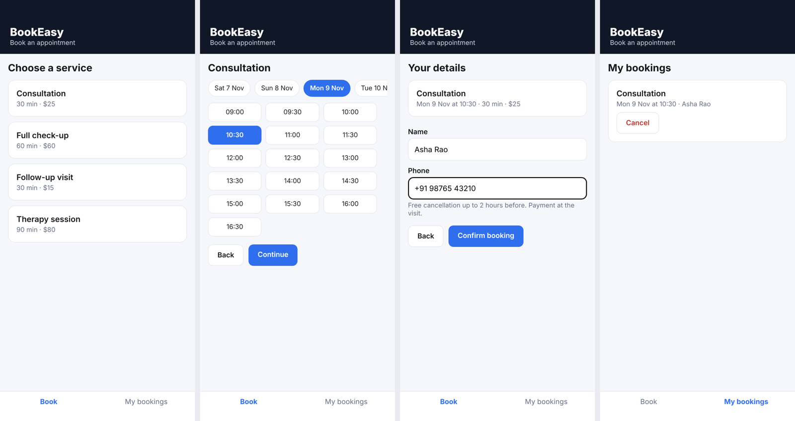

# BookEasy: appointment booking app (React Native, Expo)

A small mobile app for booking appointments at a clinic, salon or studio. Customers pick a service, a day and a free time, enter their name and phone, and can see or cancel their bookings. Built with Expo (React Native) and TypeScript. It is a portfolio project that shows how I structure a mobile app and test its booking rules, not a finished product.



## What it does

- **Services** with duration and price (fictional demo data in `src/data.ts`).
- **Free times only.** Slots follow opening hours (Mon to Sat, 09:00 to 17:00, 30 minute steps), never run past closing, need at least one hour's notice and never overlap an existing booking. A 60 or 90 minute service blocks every slot it covers.
- **Re-check on confirm.** The slot is checked again when the customer taps Confirm, in case it was taken while the screen was open.
- **Cancellation rule.** Free cancellation up to 2 hours before the start; after that the app explains why it cannot cancel.
- **Saved on the device** with AsyncStorage. Corrupt or unexpected saved data is ignored instead of crashing the app.
- Input checks for name and phone, accessible roles and selected states on buttons.

## Run it

```
npm install
npx expo start        # scan the QR code with Expo Go on Android or iOS
npm test              # 17 Jest tests
npm run typecheck
```

## Tests

17 Jest tests cover the slot rules (hours, closing time for long services, Sunday, lead time, overlaps both ways, cancelled bookings freeing time), the confirm-time re-check, the cancellation window, contact validation, helpers and the storage layer (round trip, empty, corrupt JSON, invalid entries). They pass in three time zones (UTC, New York, India). I also removed the overlap check and the cancellation window on purpose to confirm the tests fail.

## Not included (be aware before using it for real)

- **No server.** Bookings live only on the customer's phone, so the business cannot see them and two phones cannot see each other's bookings. A real version needs an API (for example the Django projects in my GitHub) so slots are checked on the server.
- No login, payments, reminders or push notifications.
- Screenshots were taken from the web build at phone size; I have not tested it on a physical device or published it to an app store.

Started from Expo's blank TypeScript template. MIT License. Built by Komarapu Jordan Ephraim.
